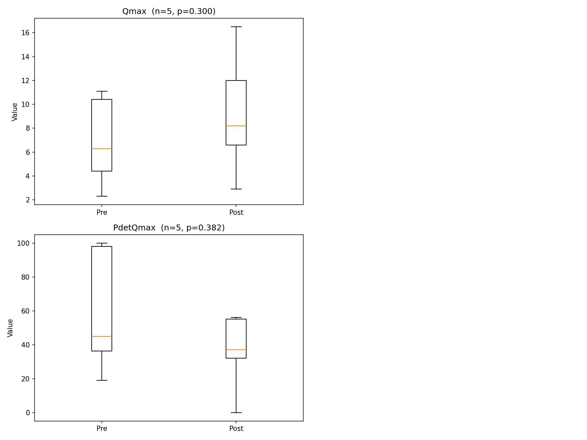
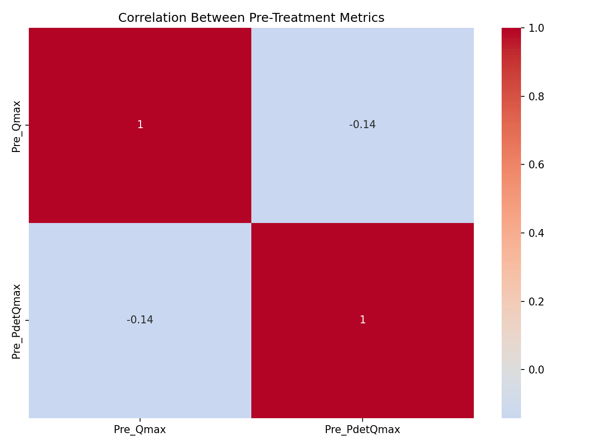

# Predicting Treatment Success from Urodynamic Metrics

Machine learning research project from Emerson Health's Department of Urology, supervised by Dr. Louis Liou (Oct 2024 – Sep 2025).

**Goal:** Use a patient's urodynamic study (UDS) results *before* treatment to predict whether the treatment will work.



## What it does

1. **Cleans the data:** Parses hand-transcribed patient records into a clean table of pre- and post-treatment values.
2. **Measures treatment effect:** Runs paired t-tests on four key metrics before vs. after treatment.
3. **Visualizes results:** Boxplots, a correlation heatmap, and feature importance charts.
4. **Predicts success:** Trains a random forest classifier on pre-treatment metrics.

**Treatment success** is defined as max flow rate (Qmax) improving by more than 20% **and** bladder capacity improving by more than 10%.

## Metrics used

| Metric | Meaning |
|---|---|
| `Qmax` | Maximum urine flow rate |
| `Pdet_max` | Maximum detrusor (bladder muscle) pressure |
| `PdetQmax` | Detrusor pressure at maximum flow rate |
| `VH2O_cap` | Bladder capacity |

## Methods

- **Statistics:** Paired t-tests (SciPy) comparing each patient's pre and post values
- **Model:** Random forest (scikit-learn) with hyperparameters tuned by grid search
- **No data leakage:** Missing-value filling and scaling happen inside a scikit-learn `Pipeline`, so they only learn from training data
- **Reliable scoring:** Stratified k-fold cross-validation, since the dataset is small

## Results



## Tech stack

Python · pandas · NumPy · scikit-learn · SciPy · Matplotlib · Seaborn

## Running it

```bash
pip install -r requirements.txt
python analysis.py
```

Plots are saved to the `figures/` folder.

## Data

Patient data is **not included** in this repository to protect patient privacy.

## Team

- Aneesh Bahierathan: data processing, statistical analysis, and model development
- Supervised by Dr. Louis Liou, Emerson Health Department of Urology
